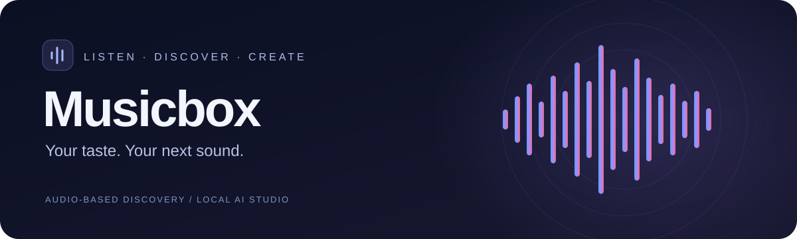
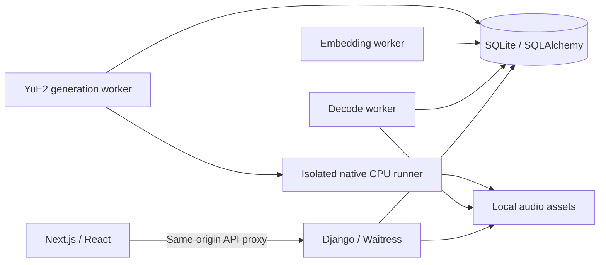

<p align="center">
  
</p>

<p align="center"><strong>A local music player that learns what moves you — with a private AI music studio.</strong></p>

<p align="center">
  
  
  
  
  
</p>

<p align="center"><a href="#quick-start">Quick start</a> · <a href="#ai-studio">AI Studio</a> · <a href="#architecture">Architecture</a> · <a href="#development">Development</a></p>

## Meet Musicbox

Bring your music, explore your taste, and create something new. Musicbox combines a responsive player, audio-based discovery and local music generation in one dark, focused interface.

| Listen | Discover | Create |
| --- | --- | --- |
| Shared catalog and private uploads | Full-catalog audio recommendations | Local YuE2 generation |
| Search, filters, favorites and playlists | Lasting taste blended with recent listening | Vocals or instrumentals, lyrics and language controls |
| Seeking, queues and byte-range streaming | Distinct taste mixes and smart autoplay | Eight variations to audition, choose and save |

**Private by browser.** No account setup is required. Your browser session owns your uploads, likes, playlists and generated tracks. Keep its cookies to retain access; cross-device account sync is not implemented.

**Personalization is your choice.** Browse the library by default. Turn on Personalize for audio-profile recommendations, Focus/Balanced discovery and smart continuation.

## Quick start

The managed launchers target **Windows x64 with PowerShell**. Install **Python 3.12**, **Node.js 24** and **pnpm 11.25.0**, available on PATH.

```powershell
git clone https://github.com/NegativeGravity/music-box.git
cd music-box

# Install dependencies, seed original synthetic demo clips, and build the UI.
.\scripts\setup.ps1

# Start the web app, Django API, and background audio workers.
.\scripts\start.ps1
```

Open **[localhost:3000](http://127.0.0.1:3000)**. Stop managed services with `scripts\stop.ps1`. Use `setup.ps1 -NoDemo` for an empty library, or `start.ps1 -Dev` for frontend development. To select Python explicitly, pass `-PythonPath 'C:\path\to\python.exe'` to setup.

### Bring your own library

Upload audio through the interface, or import a shared catalog:

```powershell
.venv\Scripts\python.exe scripts/import_catalog.py `
  --folder 'C:\Music\MyLibrary' `
  --manifest 'C:\Music\catalog.csv'
```

Use [`scripts/catalog.example.csv`](scripts/catalog.example.csv) for the expected columns. Import audio you have permission to play and analyze. Songs, session databases and generated audio stay local and are excluded from Git.

### Enable CLAP recommendations

The basic app uses a lightweight spectral audio representation. Prepare the pinned CLAP model for richer audio embeddings:

```powershell
.\scripts\setup.ps1 -WithClap
```

This downloads model assets locally and queues background embedding upgrades. Model weights are not shipped in this repository.

## AI Studio

Install the pinned **audio.cpp v0.9.1 CPU runtime** and **YuE2-3B Q8** assets, then enable generation:

```powershell
.\scripts\setup_yue2.ps1 -PythonExe '.\.venv\Scripts\python.exe'
.\scripts\start.ps1 -Dev -WithAiMusic
```

Choose style inspirations, describe the music, select vocals or instrumental, and add lyrics for a vocal take. The worker produces eight variations sequentially. Listen, choose your favorite, download its WAV, or save a private library copy. Cancellation preserves completed variations.

| Setting | Current behavior |
| --- | --- |
| Runtime | Native Windows CPU; no cloud generation API |
| Variations | Eight distinct seeds; listener selects the result |
| Languages | English and Chinese controls |
| Duration | Panel default: up to 30 seconds; actual duration is measured |
| Memory | 8 GiB available before a native stage; stops below a 2 GiB reserve |
| Recovery | Durable queue, attempt-specific acknowledgement and interpreter ownership |
| Output | Private WAV with candidate/model provenance on save |

**Know the boundary.** Eight variations do not reproduce the published automatic Best-of-8 ranking pipeline. Selected songs supply genre cues; direct waveform conditioning, stem separation and multi-song remixing are not implemented. Instrumentals use a generated symbolic score with its vocal melody moved into the instrumental part. Audible quality, lyrics, instrumental purity and CPU generation time have not been evaluated locally. Language controls are not a language-quality claim.

The internal generation API accepts a 10–60-second explicit maximum; the panel uses 30 seconds. ACE-Step adapters remain for historical compatibility and explicit opt-in use. YuE2 is the default engine.

## Architecture



Django handles HTTP; SQLAlchemy owns domain persistence. Workers process durable queues. Next.js proxies `/api/*` to Django so browser cookies and audio requests share an origin. Audio routes enforce ownership before streaming; mutations require CSRF protection.

```text
music-box/
├── frontend/           Next.js app, player, discovery, Studio and browser tests
├── backend/            Django HTTP layer, domain services, workers and Python tests
├── scripts/            Setup, lifecycle, catalog import and model installers
├── docs/assets/        README artwork
├── .github/workflows/  Backend checks, frontend typecheck and build
└── .env.example        Environment variable reference
```

Runtime state lives in the ignored `.data/` directory. This source distribution contains no personal library, session database, downloaded runtime, model weights, dependencies, build output or previous development history. The small WAV in `frontend/tests/fixtures/` is synthetic test audio.

## Development

After setup, from the repository root:

```powershell
.venv\Scripts\python.exe backend/manage.py check
.venv\Scripts\python.exe -m pytest -q
pnpm --dir frontend typecheck
pnpm --dir frontend build
```

For browser checks, start the app with its demo library and installed Google Chrome:

```powershell
.\scripts\start.ps1 -Dev
pnpm --dir frontend test:e2e
```

Generation software tests use synthesized audio and fixture processes, without model inference. See [`backend/README.md`](backend/README.md) and [`frontend/README.md`](frontend/README.md) for independent development.

`.env.example` documents configuration; Django does not load it automatically. Export variables in the launching shell to override defaults. The managed launcher accepts `-DataDir 'C:\MusicboxData'`; use `-AiDataRoot 'C:\MusicboxModels'` for a separate generation asset directory after installing YuE2 into `C:\MusicboxModels\yue2` with `setup_yue2.ps1 -DataRoot`.

## Status and third-party components

Musicbox is a local prototype. Public hosting, cross-device accounts, automatic musical-quality ranking and personalized stem remixing remain future work.

The YuE2 ABC parser's [Apache 2.0 license](backend/app/vendor/YUE2_LICENSE) and [attribution](backend/app/vendor/YUE2_NOTICE.txt) are retained. Model weights have separate terms; see the [YuE model license](https://github.com/multimodal-art-projection/YuE/blob/main/MODEL_LICENSE), particularly for company commercial use. Model installation does not grant rights to third-party songs. A license for Musicbox application code has not been declared.
